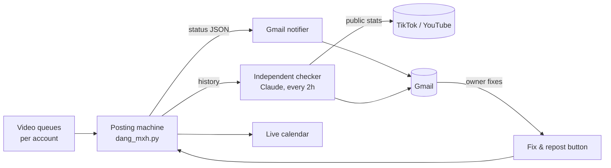

# auto-upload-social-media

A personal automation system that publishes short videos to **TikTok, Instagram Reels, Threads and Facebook Pages** on a schedule, verifies every post, and keeps the owner informed by **Gmail** — built for a one-person media studio running several YouTube/TikTok channels.

> **How it was built:** I designed the workflow, the rules and the safety checks, and operate the system daily. The code was written together with **Claude Code (Anthropic's AI coding agent)**: I described what I needed in Vietnamese, reviewed each result, and had a second, independent AI agent review the code before shipping. This repository is as much a record of *directing AI to build reliable tools* as it is of the code itself.

## The problem
Running several channels alone means: videos must go out at fixed times on 4 networks, logins expire, platforms change their UI, and a silent failure can mean a channel posts nothing for days. I needed a system that posts by itself, **never posts twice or to the wrong account**, and tells me exactly what broke and how to fix it — in plain language, because I am not a programmer.

## What it does
| Part | Folder | Runs |
|---|---|---|
| **Posting machine** — picks the next video from each account's queue and posts it in its time slot; only records "posted" with proof (post ID/link) | `dang-mxh/` | Windows Task Scheduler, every 10 min |
| **Gmail notifier** — "posting in ~30 min", "posted (link)", "failed / missed slot / login expired / queue empty" in one digest | `he-thong-mxh/thong-bao/thong_bao_mxh.py` | every 10 min |
| **Fix-and-repost button** — after a fix: returns failed videos to the queue (never ones that may already be live), schedules an immediate make-up post, then emails "posted — fixed: …" | `he-thong-mxh/DA_SUA_XONG.bat` → `thong-bao/dang_bu.py` | on demand |
| **Independent checker** — a separate agent (Claude scheduled task) that every 2 h verifies each post is on the right account, reads public stats (TikTok, YouTube), checks the owner's content rules, and emails one report with causes and fixes | `he-thong-mxh/kiem-2-gio/`, `kiem-tra-mxh/` | every 2 h |
| **Live posting calendar** — 7 days back / 7 days ahead, every channel and network, with stats | `he-thong-mxh/lich/lich_dang.py` → `lich-dang.html` | every 10 min |
| **Patched uploader** — fixes to the open-source [social-auto-upload](https://github.com/dreammis/social-auto-upload) (MIT) after TikTok/Instagram/Facebook UI changes | `social-auto-upload-patches/` | — |



## Design rules (the interesting part)
- **Never post to the wrong account:** every account pins its `@handle`; if the saved login belongs to someone else, the machine refuses and keeps the queue.
- **Never claim success without proof:** "posted" only when the network returns a post ID/link. "Clicked publish but unsure" is a separate state that is **never** auto-retried (avoids duplicates).
- **No lost alerts:** every email is queued to disk before sending; network or password problems mean it is sent later, not dropped.
- **No alert spam:** each alert has a stable key and is sent once; the checker only reports *new* problems.
- **One source of truth:** every bot reads the same account config, so adding a channel is one config block (`he-thong-mxh/THEM-KENH.md`).
- **Secrets never leave the laptop:** cookies, tokens, the Gmail app password, stats and the real config are git-ignored; this repo is code only (`dang-mxh/cau-hinh.example.json` shows the config shape).

## Tech
Python 3.12 (standard library: `smtplib`, `urllib`, `json`, `pathlib`), Playwright/Patchright browser automation (via social-auto-upload), YouTube Data API, Windows Task Scheduler, Claude Code scheduled tasks, ffmpeg.

## Run the self-test
```
python -X utf8 he-thong-mxh/kiem-thu/test_mxh.py
```
Code comments and messages are in Vietnamese (the operator's language).

## Notes
Automated posting through a browser may conflict with platform terms; this is a personal tool for my own accounts, shared to show the engineering. License: MIT (see `LICENSE`); `social-auto-upload-patches/` keeps the original MIT license of dreammis.
